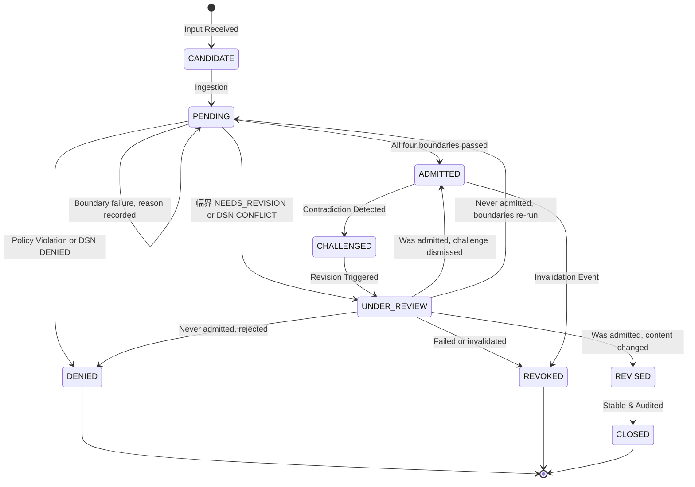

# CHI / CCGF Architecture Note

> **CCGF governs not only what the system may say, but what it may know, infer, revise, and render.**

This document describes the formal architecture of the personal **CHI Platform** and its **CHI Cognitive Governance Framework (CCGF)**. It serves as the descriptive architectural reference and companion to [`AGENTS.md`](file:///Users/robertlai/Projects/chi/AGENTS.md) (the canonical, imperative doctrine governing agent behavior in this repository). Where this note and `AGENTS.md` disagree, **`AGENTS.md` is strictly authoritative**.

CHI is not a chatbot workspace, an ordinary RAG stack, or an unconstrained autonomous agent workflow. It is a **contract-governed, assurance-native hypergraph intelligence system**: a governed reasoning platform in which generative models may propose, but only CHI authorities may admit, trace, project, reconcile, or close knowledge.

---

## 1. Core Axioms & Law

```text
       ┌────────────────────────────────────────────────────────┐
       │         Generation proposes. Governance admits.        │
       └────────────────────────────────────────────────────────┘
       ┌────────────────────────────────────────────────────────┐
       │             No Accord. No Coherence. No Render.        │
       │        Accord before Knowledge; Knowledge before Display.│
       └────────────────────────────────────────────────────────┘
```

1. **Generation proposes; Governance admits**: Model outputs—originating from any agent, local or remote—are strictly *unadmitted candidates* until they clear CCGF admission gates. Fluency, confidence, or plausibility never constitute evidence or ground truth.
2. **No Accord, No Coherence, No Render**: Knowledge must achieve deterministic semantic accord and structural coherence before being admitted into memory, and must be formally admitted before rendering in projections or user interfaces.
3. **Fail-Closed by Construction**: If any gate along the governance pipeline cannot be verified, CHI defaults to denial, pending status, or bounded uncertainty. It never optimistically promotes unverified state.

---

## 2. The Five Boundaries (五界)

CCGF organizes cognitive governance into exactly five sequential boundaries. Operational order and precedence are strictly immutable:

```text
名界 (Semantic Admission) 
  ──► 據界 (Evidence Governance) 
        ──► 徑界 (Path Governance) 
              ──► 幅界 (Uncertainty Governance) 
                    ──► 修界 (Revision Governance)

Precedence Rule: 名界 > 據界 (Semantic agreement precedes evidence binding)
```

| Boundary | Governance Responsibility | On Failure / Rejection |
|---|---|---|
| **名界 (Semantic Admission)** | Converts candidate terms into typed, scoped, and admissible semantic objects via Deterministic Semantics Narrowing (DSN). | **Do not admit** — record the DSN state: `BOUNDED_AMBIGUOUS`, `UNRESOLVED`, `CONFLICT`, or `DENIED`. |
| **據界 (Evidence Governance)** | Binds claims to verifiable provenance, cryptographic hashes, authority tiers, and receipts. | **Do not trust** — record `UNSUPPORTED` or `UNTRUSTED`; the claim stays `PENDING`. |
| **徑界 (Path Governance)** | Validates logical, causal, inferential, and dependency paths across hypergraph structures. | **Do not infer** — record `PATH_BREAK`; roll back to Semantic Admission. |
| **幅界 (Uncertainty Governance)** | Bounds confidence intervals, scope limits, boundary conditions, and non-applicability domains. | **Do not judge** — record `NEEDS_REVISION`; trigger revision. A successful bounding returns an uncertainty envelope. |
| **修界 (Revision Governance)** | Reconciles contradictions, state transitions, ledger revocations, replacements, and formal closures. | **Do not stabilize** — the outcome is `UNDER_REVIEW`, `REVISED`, or `REVOKED`; block projection. |

Failure reasons and the states an object holds afterward are defined once, in the Fail-Closed Transition Matrix (§4) and the state machine (§7).

---

## 3. Deterministic Semantics Narrowing (DSN)

DSN is **not** a separate boundary; it is the deterministic stabilization sub-engine operating within **名界 (Semantic Admission)**.

```text
┌─────────────────────────────────────────────────────────────────────────────────┐
│                           名界 (Semantic Admission Gate)                         │
│                                                                                 │
│   Candidate Term ──► [Ambiguity Detection] ──► [Candidate Semantic Mapping]     │
│                             │                                │                  │
│                             ▼                                ▼                  │
│                     [Context Binding]  ──► [Type Commitment] ──► [Admission Gate]│
└─────────────────────────────────────────────────────────────────────────────────┘
```

### DSN State Transitions & Invariants
DSN maps raw, under-specified natural language into typed semantic objects *before* evidence binding or inference is permitted. DSN emits exactly one of five explicit states:

```text
                       ┌──► NARROWED (Admissible to 據界)
                       ├──► BOUNDED_AMBIGUOUS (Retains explicit scope envelope; 據界 only per binding, under an ambiguity allowance)
Candidate Expression ──┼──► UNRESOLVED (Halted; awaiting contextual clarification)
                       ├──► CONFLICT (Mutually exclusive semantic candidates)
                       └──► DENIED (Out-of-scope, invalid, or policy violation)
```

* **The DSN Invariant**: An LLM's "most probable interpretation" is *never* accepted as deterministic narrowing. Evidence is **never** bound to an `UNRESOLVED`, `CONFLICT`, `DENIED`, or uncommitted term, nor to a `BOUNDED_AMBIGUOUS` term without an ambiguity allowance.
* **Ambiguity Allowance**: Evidence may bind to a hyperedge with a `BOUNDED_AMBIGUOUS` member only under an ambiguity allowance: a receipt (`AMBIGUITY_ALLOW`, decision `BOUND`) granted by a human authority for one binding, naming the exact combinations of meanings the evidence holds under (each combination assigns one remaining meaning to every bounded member, so two ambiguous terms are never approved separately). When a covered term is narrowed, combinations that no longer match are dropped: the allowance stays in force while a covered term is still bounded; once every covered term is narrowed the binding stands as an ordinary one if a granted combination matches, and is voided if none remains. If that leaves a `PENDING` hyperedge without support it stays `PENDING` with `UNSUPPORTED` recorded; if it leaves an `ADMITTED` hyperedge without support, the hyperedge becomes `CHALLENGED` and is withdrawn from projection. Without an allowance the binding is refused and the claim stays `PENDING`.

---

## 4. The Governed Cognition Chain (G-A-T-P-R-C)

Every governed transaction passes through the complete CCGF chain front-to-back without stage collapsing or informal shortcuts:

```text
User / Agent Input
       │
       ▼
[ Cognitive Router ] ────────────► (Fast-path / Diagnostic only if non-governed)
       │
       ▼ (Governed Path)
[ Deterministic Semantics Narrowing (DSN) ]
       │
       ▼
[ Semantic Admission Gate ]        ─── (名界)
       │
       ▼
[ Evidence Binding Gate ]          ─── (據界)
       │
       ▼
[ Path Validation Gate ]           ─── (徑界)
       │
       ▼
[ Uncertainty Bounding Gate ]      ─── (幅界)
       │
       ▼
[ Knowledge Projection ]
       │
       ▼
[ Reconciliation & Revision ]      ─── (修界)
       │
       ▼
[ Formal Ledger Closure ]          ─── (修界 Gate)
```

**Mnemonic**: **G → A → T → P → R → C**  
*(Generation → Admission → Trace → Projection → Reconciliation → Closure)*

The mnemonic is shorthand for the chain above. It maps onto the chain's stages as follows:

| Letter | Covers | Note |
|---|---|---|
| G | Before the chain | The generative layer proposes candidates; its output enters the chain as Input. Outside CCGF. |
| A | Cognitive Router, DSN, Semantic Admission, Evidence Binding, Path Validation, Uncertainty Bounding | The router is A's entry: it routes and never admits. What "admitted" requires depends on the kind of object. |
| T | Every stage | Provenance, hashes, receipts, paths, and lineage are recorded at each stage. Not a stage of its own. |
| P | Projection | A revocable, rebuildable view. |
| R | Reconciliation | |
| C | Closure | |

T is listed between A and P as a reading order, not as a claim that tracing starts after admission.

### Fail-Closed Transition Matrix

A failure reason is recorded on the receipt of the boundary decision; it is not an object state. The state afterward is an admission state (§7).

| Failure at | Reason recorded | Admission state afterward | Route |
|---|---|---|---|
| 名界 (Semantic) | The DSN state: `BOUNDED_AMBIGUOUS`, `UNRESOLVED`, `CONFLICT`, or `DENIED` | `PENDING`; `UNDER_REVIEW` for `CONFLICT`; `DENIED` for `DENIED` | Halt admission |
| 據界 (Evidence) | `UNSUPPORTED` (no admitted evidence bound) or `UNTRUSTED` (evidence bound but insufficient for the required authority tier, or contradicting) | `PENDING` | Halt trust binding |
| 徑界 (Path) | `PATH_BREAK` | `PENDING` | Rollback to 名界 |
| 幅界 (Uncertainty) | `NEEDS_REVISION` | `UNDER_REVIEW` | Route to 修界 |
| 修界 (Revision) | None of its own | `UNDER_REVIEW`, `REVISED`, or `REVOKED` | Exclude from Projection unless admitted and unchallenged |

Projection is a derived, rebuildable view of admitted knowledge that is not under challenge. A claim challenged or revoked after projection is withdrawn from it; the chain order does not change.

*Interactive Walkthrough*: [`chi/diagrams/ccgf-chain.html`](file:///Users/robertlai/Projects/chi/diagrams/ccgf-chain.html). The walkthrough shows only some failure outcomes (a 名界 denial, a 據界 pending, and a new candidate after closure); the matrix above gives all five.

---

## 5. System 1 / System 2 Authority Architecture

System 1 vs. System 2 in CHI is an **architectural authority boundary**, not a cognitive metaphor or model capability designation.

```text
                ┌──────────────────────────────────────────────┐
                │          SYSTEM 1: Generative Layer          │
                │   (Proposes Candidates, Hypotheses, Code)    │
                │        Claude Code / Goose / Local Models    │
                └──────────────────────┬───────────────────────┘
                                       │ (Candidates only)
                                       ▼
       ═════════════════════════════════════════════════════════════════
                      CHI CCGF GOVERNANCE BOUNDARY (GATES)
       ═════════════════════════════════════════════════════════════════
                                       │
                                       ▼
                ┌──────────────────────────────────────────────┐
                │          SYSTEM 2: Adjudication Layer        │
                │  (Enforces Boundaries, Generates Receipts)   │
                │  Deterministic Validators + SQLite Authority │
                └──────────────────────────────────────────────┘
```

* **System 1 (Generative / Candidate Producer)**: Generates candidate structures, code, queries, hypotheses, and natural language. Output is strictly candidate state, regardless of whether it was generated by a cloud frontier model or a local model.
* **System 2 (Adjudicative / Authority Enforcer)**: Executes boundary checks, evidence verification, path validation, uncertainty bounding, and ledger commits. Output is accompanied by an append-only receipt.

### Local Model Guidance & Runtime Topology

When running local models on Apple Silicon (via MLX / vLLM-MLX runtimes), models are assigned specific structural roles behind the CHI Gateway:

| Lane / Role | Target Model Class | Gateway Responsibility |
|---|---|---|
| **Local System 1 Heavy Context** | Qwen / Gemma / Llama (MLX) | Proposes high-context candidates and draft structures |
| **System 2 Canonical Reasoning** | Small, deterministic Qwen-class | Governed reasoning wired strictly through CCGF gates |
| **Builder / Tool Lane** | Specialized Coder models | Code generation, patch synthesis, tool invocation |
| **Semantic Embeddings** | BGE / ModernBERT series | Vector generation for hybrid retrieval coordination |
| **Reranking Authority** | Configured CHI Reranker | Scored ranking bounded by Authority Tier policy |

---

## 6. Agent Roles (Workers, Not Authorities)

Agents in the CHI Platform are **delegated workers**, never sovereign authorities. They may propose modifications, extract evidence candidates, and validate invariants, but they cannot bypass SQLite authority ledgers or fabricate receipts.

```text
 1. Governance Architect Agent ──► Preserves Five Boundaries & pipeline integrity
 2. DSN Agent                  ──► Performs semantic narrowing & type commitment
 3. Evidence Agent             ──► Ingests provenance, hashes, & assigns authority tiers
 4. Path Validation Agent      ──► Audits inferential, causal, & dependency chains
 5. Uncertainty Agent          ──► Quantifies confidence envelopes & scope boundaries
 6. Revision Agent             ──► Reconciles contradictions, revocations, & closures
 7. Projection Agent           ──► Renders admitted knowledge to UI / downstream targets
```

---

## 7. Admission State Machine

Governed objects move through explicit, enumerable lifecycle states. This state machine describes hyperedges (claims). A semantic object is governed by its DSN state and semantic admission (名界) alone; `NARROWED` is a DSN state, not an admission state. The same nine admission states are used for both kinds; a semantic object is admitted by 名界 alone, so it reaches `ADMITTED` without the 據界, 徑界, and 幅界 conditions.



A rendered copy of this diagram is kept in `admission-state-machine.svg` beside this file; regenerate it whenever the diagram changes.

`BOUNDED_AMBIGUOUS`, `UNRESOLVED`, and `CONFLICT` are DSN states, and `UNKNOWN` and `NOT_PROJECTABLE` are projection labels. None is an admission state.

`DENIED`, `REVOKED`, and `CLOSED` are terminal. Reopening a hyperedge or a semantic object, raising a revised candidate after a denial, or re-admitting revised content starts a new `CANDIDATE` that names the earlier one in its `predecessor_ids`; the earlier one is never resumed. The new candidate's id includes its predecessors, so identical content raised again gets a new id. "Reaffirmed" is an outcome recorded on the receipt, not a state.

---

## 8. Hypergraph Architecture & Governance Doctrine

### 8.1 Why Binary Graphs Fail in Governed Intelligence
Conventional knowledge graphs use pairwise binary edges: $e = (u, v)$. In contract-governed, assurance-native reasoning, **binary edges fail completely** because real-world knowledge, compliance, and causal logic are inherently **$n$-ary, contextual, temporal, and governed**:

```text
  Conventional Binary Graph (Lossy)             CHI Governed Hyperedge (Lossless)
  ─────────────────────────────────             ─────────────────────────────────
         [Party A] ──(owes)──► [Party B]               ┌───────────────────────────────┐
                                                       │   HYPEREDGE: $e_1$             │
  * Loses: Under what obligation?                      │   Type: OBLIGATION            │
  * Loses: Under which clause/condition?               │   Members:                    │
  * Loses: Valid for what time window?                 │     - Party A (Debtor)        │
  * Loses: Supported by what evidence?                 │     - Party B (Beneficiary)   │
  * Loses: Admitted under what receipt?                │     - Clause 4.2 (Condition)  │
  * Loses: With what uncertainty bounds?               │     - Asset Pool (Target)     │
                                                       │   Scope: Financial/Q3         │
                                                       │   Validity: [2026-01, 2026-12]│
                                                       │   Evidence: [doc_hash_8f9c]   │
                                                       │   Receipt: [rcpt_admit_4a21]  │
                                                       └───────────────────────────────┘
```

Decomposing an $n$-ary relation into multiple binary pairs causes **relational loss**, catastrophic loss of context, and makes it impossible to attach a single cryptographic receipt to the joint relationship.

### 8.2 Mathematical & Ontological Structure
The CHI Hypergraph is formally defined as:

$$\mathcal{H} = (\mathcal{V}, \mathcal{E}, \mathcal{R}, \mathcal{T}, \Phi)$$

Where:
* **$\mathcal{V}$ (Vertices)**: The set of typed, DSN-narrowed Semantic Objects ($v \in \mathcal{V}$).
* **$\mathcal{E}$ (Hyperedges)**: The set of admitted hyperedges. Each $e \in \mathcal{E}$ binds an arbitrary subset of nodes $V_e \subseteq \mathcal{V}$.
* **$\mathcal{R}$ (Incidence Role Map)**: A mapping $r: (e, v) \to \text{Role}$ assigning explicit semantic roles from a closed list (`SUBJECT`, `OBJECT`, `PREDICATE`, `CONDITION`, `SCOPE_QUALIFIER`, `BENEFICIARY`, `ASSUMPTION`); an unknown role is rejected. Labels such as Debtor or Target in examples are display labels for `SUBJECT` and `OBJECT`.
* **$\mathcal{T}$ (Temporal Validity)**: An interval $[t_{\text{valid\_from}}, t_{\text{valid\_to}}]$ defining when the hyperedge is active.
* **$\Phi$ (Governance Envelope)**: $\Phi(e) = (\text{AdmissionState}, \text{AuthorityTier}, \text{ReceiptID}, \text{LineageHash}, \Omega)$ where $\Omega$ represents the bounded uncertainty envelope.

### 8.3 Hypergraph Interaction Across the Five Boundaries

```text
 1. 名界 (Semantic)   ──► Constructs typed vertices ($V_e$) and validates relation signatures.
 2. 據界 (Evidence)   ──► Pins immutable evidence receipts ($E_e$) to the hyperedge.
 3. 徑界 (Path)       ──► Traverses hyperpaths ($\pi = e_1 \circ e_2 \circ \dots \circ e_k$) to validate
                          causal, inferential, and control-mapping integrity.
 4. 幅界 (Uncertainty)──► Binds the uncertainty envelope ($\Omega$) across the entire relation.
 5. 修界 (Revision)   ──► Cascades invalidations and revisions across connected hyperedges.
```

### 8.4 Path Governance over Hypergraphs (徑界)
Path Governance validates hypergraph traversal. An inferential chain is valid if and only if:
1. **Connectivity**: Adjacent hyperedges share necessary interface nodes with compatible roles:
   $$e_i \cap e_{i+1} \supseteq V_{\text{interface}}$$
2. **Temporal Overlap**: The intersection of validity intervals across the path is non-empty:
   $$\bigcap_{i=1}^k [t_{\text{start}}^{(i)}, t_{\text{end}}^{(i)}] \neq \emptyset$$
3. **No Unsupported Inferential Leaps**: Every premise node required by a downstream conclusion hyperedge is grounded in an admitted upstream hyperedge or base evidence.
4. **Acyclicity in Causal Paths**: Directed causal or derivation paths must be acyclic (no circular reasoning).

### 8.5 Relation Signatures
Each relation type states which roles it requires and which it allows. 名界 rejects a hyperedge whose members do not satisfy its type's signature, and rejects an unknown relation type or role (fail closed). Adding a relation type or a role is a doctrine amendment.

| Relation type | Required roles | Allowed roles |
|---|---|---|
| `CLAIM` | `SUBJECT` | `PREDICATE`, `OBJECT`, `CONDITION`, `ASSUMPTION`, `SCOPE_QUALIFIER` |
| `OBLIGATION` | `SUBJECT` (obligor), `OBJECT` (what is owed), `BENEFICIARY` | `CONDITION`, `ASSUMPTION`, `SCOPE_QUALIFIER` |
| `RISK_CONTROL` | `SUBJECT` (risk or asset at risk), `OBJECT` (control) | `CONDITION`, `ASSUMPTION`, `SCOPE_QUALIFIER` |
| `CAUSAL` | `SUBJECT` (cause), `OBJECT` (effect) | `CONDITION`, `ASSUMPTION`, `SCOPE_QUALIFIER` |

`BENEFICIARY` is allowed only in `OBLIGATION`, and `PREDICATE` only in `CLAIM`, where a named predicate object is needed; elsewhere the relation type is the predicate.

---

## 9. Data Architecture & Authority Store

### 9.1 Governed Object Schemas

*The `semantic_objects` and `hyperedges` tables also hold candidates and unadmitted terms. Only rows that have been admitted (`ADMITTED`, or a later state reached from it) are semantic objects or hyperedges in the sense of §8.2.*

#### 1. Semantic Object (`semantic_objects`)
```typescript
interface SemanticObject {
  id: string;                  // Stable deterministic hash of the source (original_text, scope, source_context) and predecessor_ids; narrowing does not change it
  type: string;                // Committed domain semantic type
  label: string;               // Narrowed canonical name
  original_text: string;       // Raw candidate source text
  scope: string;               // Valid operational namespace / scope
  source_context: string;      // Ingest context URI
  dsn_state: DsnState;         // NARROWED | BOUNDED_AMBIGUOUS | UNRESOLVED | CONFLICT | DENIED
  meanings: string[];          // The finite set of remaining meanings: one if NARROWED, two or more if BOUNDED_AMBIGUOUS, empty otherwise
  narrowing_basis: NarrowingBasis; // What the narrowing rested on (context, ontology, evidence, policy, source, or user constraint) and the alternatives considered
  admission_state: AdminState; // CANDIDATE | PENDING | ADMITTED | DENIED | CHALLENGED | UNDER_REVIEW | REVISED | REVOKED | CLOSED
  created_at: number;          // UTC epoch timestamp
  updated_at: number;          // UTC epoch timestamp
  receipts: string[];          // References to append-only receipts
  predecessor_ids: string[];   // IDs of the earlier objects this one descends from (empty for a first attempt)
  lineage_hash: string;        // Hash over the predecessors and their final receipts
}
```

#### 2. Governed Hyperedge (`hyperedges`)
```typescript
interface HyperedgeRecord {
  id: string;                  // Deterministic hash of relation_type, scope, members with roles, validity, and predecessor_ids
  relation_type: string;       // CLAIM | OBLIGATION | RISK_CONTROL | CAUSAL (closed list, see §8.5)
  scope: string;               // Domain boundary / operational namespace
  admission_state: AdminState; // CANDIDATE | PENDING | ADMITTED | DENIED | CHALLENGED | UNDER_REVIEW | REVISED | REVOKED | CLOSED
  valid_from: number;          // Epoch timestamp
  valid_to: number | null;     // Epoch timestamp (null = indefinite)
  confidence_bound: number;    // Bounded confidence score [0.0 - 1.0]
  uncertainty_notes: string[]; // Bounded conditions / exceptions
  receipt_id: string;          // Authoritative admission receipt
  predecessor_ids: string[];   // IDs of the earlier hyperedges this one descends from (empty for a first attempt)
  lineage_hash: string;        // Merkle hash of predecessor hyperedges
  created_at: number;          // UTC epoch timestamp
  updated_at: number;          // UTC epoch timestamp
}

interface HyperedgeMember {
  hyperedge_id: string;        // Foreign key to hyperedges.id
  node_id: string;             // Foreign key to semantic_objects.id
  role: string;                // SUBJECT | OBJECT | PREDICATE | CONDITION | SCOPE_QUALIFIER | BENEFICIARY | ASSUMPTION (closed list)
  ordinal: number;             // Deterministic argument ordering
}

interface HyperedgeEvidenceBinding {
  hyperedge_id: string;        // Foreign key to hyperedges.id
  evidence_id: string;         // Foreign key to evidence_records.id
  polarity: 'SUPPORTS' | 'CONTRADICTS';
  receipt_id: string;          // Evidence binding receipt
  allowance_receipt_id: string | null; // AMBIGUITY_ALLOW receipt when a member is BOUNDED_AMBIGUOUS, otherwise null
  void_reason: string | null;  // Set when the binding stops counting; the row is never deleted
  voided_receipt_id: string | null; // The REVISION_CLOSE receipt that recorded the voiding
}
```

*Voiding a binding.* A binding is never deleted: it is voided with a reason and a `REVISION_CLOSE` receipt, and a voided binding no longer counts for 據界. Dismissing a `CONTRADICTS` binding, which is what allows a challenged hyperedge to be reaffirmed, needs a human authority. The system voids a `SUPPORTS` binding automatically when its allowance lapses.

#### 3. Evidence Object (`evidence_records`)
```typescript
interface EvidenceRecord {
  id: string;                  // Deterministic content hash ID
  source_id: string;           // Provenance URI / identifier
  source_type: string;         // Document | API | SystemReceipt | UserAssertion
  authority_tier: AuthTier;    // TIER_1_CANONICAL > TIER_2_ADMITTED > TIER_3_EXTRACTED > TIER_4_GENERATIVE
  provenance_uri: string;      // Immutable path or locator
  extracted_text: string;      // Canonical extracted snippet
  content_hash: string;        // SHA-256 hash of original raw content
  valid_from: number;          // Temporal validity start
  valid_to: number | null;     // Temporal validity expiration (null = indefinite)
  receipt_id: string;          // Authoritative admission receipt
}
```

#### 4. Cryptographic Receipt (`receipts`)
```typescript
interface Receipt {
  id: string;                  // Receipt hash (SHA-256)
  receipt_type: string;        // DSN_COMMIT (any DSN outcome, the decision carries the result) | SEMANTIC_ADMIT | EVIDENCE_ADMIT | HYPEREDGE_ADMIT | PATH_VALIDATE | UNCERTAINTY_BOUND | AMBIGUITY_ALLOW | REVISION_OPEN | REVISION_CLOSE
  subject_id: string;          // ID of governed object (node, hyperedge, evidence)
  decision: string;            // ADMIT | DENY | REVISE | REVOKE | BOUND | PEND | CLEAR. CLEAR: passed this stage, not yet admitted (a narrowed term). PEND: halted without denying, including a challenge or review opened. BOUND: a bound was recorded (a bounded ambiguity, an allowance, or an uncertainty envelope)
  basis: string[];             // Rules, evidence IDs, and gate criteria evaluated; an evidence receipt includes the record's content_hash
  actor: string;               // System agent or human authority
  created_at: number;          // UTC epoch timestamp
  hash: string;                // Cryptographic seal of current receipt payload
  previous_receipt_id: string; // Hash of preceding receipt in chain (Merkle lineage)
}
```

### 9.2 Authority Tiers (據界 Hierarchy)

When ranking and admitting evidence, CHI evaluates sources strictly by tier:

1. **Tier 1 (Canonical / Primary Provenance)**: Cryptographically verified artifacts, deterministic system logs, signed raw documents, authoritative external ledgers.
2. **Tier 2 (Admitted Hypergraph State)**: Previously admitted CHI knowledge supported by verified receipts and closed revision lifecycles.
3. **Tier 3 (Extracted Candidate Evidence)**: Structured extractions from external adapters (Nessus, Schwab, Obsidian, QMD) awaiting verification.
4. **Tier 4 (Generative Hypotheses)**: Model outputs, ungrounded assistant proposals, unadmitted summaries. Tier 4 records are tracked as candidates; they are never admitted evidence and never satisfy 據界 alone.

### 9.3 SQLite Authority Store Invariants
SQLite is the canonical local persistence engine for CHI:
* **WAL Mode (Write-Ahead Logging)** enabled for concurrent readers and deterministic serialized writes.
* **Relational Hypergraph Tables**: Direct implementation of `semantic_objects`, `hyperedges`, `hyperedge_members`, `hyperedge_evidence`, and `receipts` with foreign key integrity.
* **Append-Only Ledgers**: Decisions and state transitions are recorded as revision events; destructive updates without receipts are forbidden.
* **Evidence Seal**: An evidence receipt records the evidence record's `content_hash`, so a forged evidence text cannot pass even with a recomputed hash.
* **Receipts Explain State**: A record in an admitted-or-later state has its admission receipt, and every admission receipt still has its record.
* **Integrity Check**: A store must offer an integrity check that verifies the receipt chain, the evidence hashes, and the rule above.
* **Limit**: Someone who can rewrite the whole database can rebuild the whole receipt chain. Tamper-evidence against that needs the latest receipt id kept outside the database; that anchor is not yet specified.
* **Separation of Concerns**: Caches and vector indices are rebuildable ephemeral tables; authority tables are inviolable.

---

## 10. Retrieval and Ranking Formula

Retrieval is not admission. A retrieved document is merely an *Evidence Candidate*. When ranking candidate items, CHI uses a deterministic lexicographical ordering:

$$\text{Rank Score} = \text{Authority Tier} \gg \text{Scope Match} \gg \text{Evidence Quality} \gg \text{Temporal Freshness} \gg \text{Semantic Relevance}$$

* LLM rerankers may only be invoked if they run through the configured CHI reranker gateway and adhere to hard authority tier bounds.

---

## 11. Model Gateway & MCP Integration

```text
External Client (Claude Code / Goose / OpenCode / Codex)
                   │
                   ▼
          [ CHI Agent Gateway ]
          ├── Policy & Workspace Admission
          ├── Filesystem & Tool Safety Guardrails
          └── Audit & Receipt Forwarding
                   │
                   ▼
     [ Inference Runtime (vLLM-MLX) ]
     └── Pure Inference (No Policy Delegation)
                   │
                   ▼
       [ CHI Authority Services ]
```

### The MCP Doctrine
> **MCP is the interface. CHI is the authority.**

Model Context Protocol (MCP) servers expose tools, resources, and external interfaces, but CHI retains exclusive authority over admission, execution policy, ledger mutation, and projection.

* **Split-Server Pattern**:
  * *Workspace / Tool Server*: Filesystem and shell automation under safety policies.
  * *Evidence / Query Server*: High-assurance read-only hypergraph and SQLite queries.
  * *Projection / Control Server*: UI state projection and governance administration.
* **Adapter Doctrine**: External adapters (QMD, Obsidian, Nessus, Schwab, parsers) must output candidate types (`EvidenceCandidate`, `HyperedgeCandidate`), never admitted types.

---

## 12. Governed Projection & UI

Projection is rendering, not authorization:

```text
No evidence admission, no knowledge projection.
```

* **Admitted Knowledge**: Renders as authoritative state with clickable receipt provenance.
* **Pending / Narrowed Knowledge**: Renders with explicit visual indicators marking pending status.
* **Conflict / Ambiguous Knowledge**: Renders with uncertainty bounds and conflict annotations, or not at all.
* **Revoked / Denied Knowledge**: Strictly excluded from active projection views.

The UI layer is a deterministic, fail-closed projection of the underlying hypergraph ledger. UI state can never override admitted state or silently escalate uncertain claims into verified knowledge.

---

## 13. Assurance Posture & High-Assurance Workflows

CHI / CCGF is designed for high-assurance environments (aerospace standards, NIST / RMF compliance, IL5/IL6 operating envelopes, financial and national security workflows):
* **Source Traceability**: Every finding, control mapping, risk posture, and generated assertion traces directly back to raw evidence hashes.
* **Zero Optimistic Promotion**: The system prefers returning an explicit `PENDING` or `UNKNOWN` state over fabricating or guessing a missing link.
* **Audit Reproducibility**: Given an initial SQLite ledger and an append-only receipt log, any past system state can be deterministically replayed and audited.

---

*See [`AGENTS.md`](file:///Users/robertlai/Projects/chi/AGENTS.md) for the binding operational directives, implementation rules, and agent workflows governing this repository.*
