# Proposed shared state vocabulary (covers B1, B2, B5)

**Status (2026-09-19): APPLIED to `docs/ARCHITECTURE.md` and all four `AGENTS.md` copies, with the three deviations below. The draft text that follows is otherwise kept as written and is now history.**

Deviations from the draft as applied:
1. The 名界 rows say only "record the DSN state" and do not mention "BOUNDED_AMBIGUOUS without an allowance": the recorded-allowance mechanism (B4) is still undefined and the doctrine must not cite it.
2. Open sub-questions 1 and 2 were resolved as recommended: a never-admitted candidate routed to 修界 (by a 幅界 failure or a DSN `CONFLICT`) enters `UNDER_REVIEW`, then returns to `PENDING` under a new receipt or goes to `DENIED`. So a DSN `CONFLICT` leaves the object `UNDER_REVIEW` (the draft table said `PENDING`), and the state machine has `UNDER_REVIEW to PENDING` and `UNDER_REVIEW to DENIED` edges.
3. The §9.1 note added earlier (A3) was reworded: "rows that have been admitted (`ADMITTED`, or a later state reached from it)", because `UNDER_REVIEW` can now also hold a never-admitted candidate.

Sub-question 3 (keep the name `UNDER_REVIEW`) was resolved as recommended: kept.

**Amended later the same day** by `whitepaper-discrepancies.md` items L1 and L2: the state machine gained `UNDER_REVIEW to ADMITTED` (challenge dismissed, reaffirmed), and `DENIED`, `REVOKED` and `CLOSED` are stated to be terminal, with reopening expressed as a new candidate linked by lineage. The diagram in this file does not show that edge; `ARCHITECTURE.md` §7 is current. It is the design behind items B1, B2 and B5 of `proposed-doctrine-edits.md`, written as one piece because those three items share one list of states.

## The problem in one table

Six lists of "admission states" exist today, and they are not the same list:

| Where | Values |
|---|---|
| `AGENTS.md:457-478` "Admission States" | 16: GENERATED, CANDIDATE, PENDING, NARROWED, ADMITTED, DENIED, BOUNDED_AMBIGUOUS, UNRESOLVED, CONFLICT, CHALLENGED, UNDER_REVIEW, REVISED, REVOKED, CLOSED, UNKNOWN, NOT_PROJECTABLE |
| `AGENTS.md:496` semantic object `admission_state` | 8: CANDIDATE, PENDING, ADMITTED, DENIED, CHALLENGED, REVISED, REVOKED, CLOSED |
| `ARCHITECTURE.md` §9.1 `SemanticObject.admission_state` | 6: CANDIDATE, PENDING, ADMITTED, DENIED, REVISED, REVOKED |
| `ARCHITECTURE.md` §9.1 `HyperedgeRecord.admission_state` | 6: CANDIDATE, PENDING, ADMITTED, CHALLENGED, REVISED, REVOKED |
| `ARCHITECTURE.md` §7 state machine | 10: CANDIDATE, PENDING, NARROWED, DENIED, ADMITTED, CHALLENGED, UNDER_REVIEW, REVISED, CLOSED, REVOKED (plus 5 "reachable non-terminal": BOUNDED_AMBIGUOUS, UNRESOLVED, CONFLICT, UNKNOWN, NOT_PROJECTABLE) |
| `AGENTS.md:389-392` Revision Agent | ADMITTED to CHALLENGED to UNDER_REVIEW to REVISED to CLOSED; ADMITTED to REVOKED; PENDING to ADMITTED or DENIED |

The 16-value list mixes three different things: where a governed object is in its lifecycle (PENDING, ADMITTED, ...), the outcome of narrowing a term (NARROWED, BOUNDED_AMBIGUOUS, ...), and how something is labelled when shown (UNKNOWN, NOT_PROJECTABLE). Failure outcomes are a fourth thing, and there are three conflicting sets of names for them (`AGENTS.md:199-205`, `ARCHITECTURE.md` §2 lines 45-49, §4 matrix lines 124-128).

## Proposal: four separate things, each with its own list

### 1. DSN state (per semantic candidate or object): unchanged, 5 values
`NARROWED`, `BOUNDED_AMBIGUOUS`, `UNRESOLVED`, `CONFLICT`, `DENIED`.
`NARROWED`, `BOUNDED_AMBIGUOUS`, `UNRESOLVED` and `CONFLICT` are removed from every admission-state list; they live only here.

### 2. Admission state (per semantic object and per hyperedge): one list, 9 values
`CANDIDATE`, `PENDING`, `ADMITTED`, `DENIED`, `CHALLENGED`, `UNDER_REVIEW`, `REVISED`, `REVOKED`, `CLOSED`.
- The same list for both kinds, replacing the two different §9.1 enums and the `AGENTS.md:496` one. This is the union that makes every transition the docs already describe expressible (hyperedges need `DENIED`, semantic objects need `CHALLENGED`, both need `UNDER_REVIEW` and `CLOSED`).
- `NARROWED` leaves this list (ADR 0002: it is a DSN state).
- `GENERATED` leaves this list: a generated statement is a `CANDIDATE`. `AGENTS.md:478` says it "starts as `GENERATED` or `CANDIDATE`"; two names for the start state is the ambiguity to remove.

### 3. Failure reason (recorded on the receipt of a boundary decision, not stored as an object state)
Each boundary that stops a candidate records why, and the object stays in the admission state shown:

| Boundary | Reason code | Admission state after | Route |
|---|---|---|---|
| 名界 | the DSN state (`UNRESOLVED`, `CONFLICT`, `DENIED`, or `BOUNDED_AMBIGUOUS` without an allowance) | `PENDING`, or `DENIED` for a DSN `DENIED` | Halt admission |
| 據界 | `UNSUPPORTED` (no admitted evidence bound) or `UNTRUSTED` (evidence bound but insufficient for the required authority, or contradicting) | `PENDING` | Halt trust binding |
| 徑界 | `PATH_BREAK` | `PENDING` | Roll back to 名界 |
| 幅界 | `NEEDS_REVISION` | `UNDER_REVIEW` | Route to 修界 |
| 修界 | none of its own: outcome is `UNDER_REVIEW`, `REVISED`, or `REVOKED` | as named | Exclude from projection unless admitted and unchallenged |

What this resolves:
- §2's `AMBIGUITY` is dropped (it duplicates the DSN states). `UNSUPPORTED` and `UNTRUSTED`, which §2 and §4 each name one of, are both kept because they mean different things.
- `BOUNDED_UNCERTAINTY` (§2) is not a failure state: it is what a successful 幅界 returns, an uncertainty envelope. The failure code is `NEEDS_REVISION` (§4).
- `UNSTABLE` (§4) is dropped; it appears nowhere else.
- `PATH_BREAK` now leads to `PENDING`, not `DENIED`, so §7 agrees with §4 and `AGENTS.md:211`.

### 4. Projection label (derived from the above, never stored as authority)
`Admitted`, `Pending Evidence`, `Bounded Ambiguous`, `Challenged`, `Revised`, `Revoked`, `Closed`, `Unknown`, `Not Projectable` (the existing `AGENTS.md:701-712` list, unchanged). `UNKNOWN` and `NOT_PROJECTABLE` are labels only: `Unknown` means nothing is recorded, `Not Projectable` means a stored state that must not be shown as knowledge. Consistent with D8: projection is a rebuildable view.

## The corrected hyperedge state machine (replaces the §7 diagram)

```mermaid
stateDiagram-v2
    [*] --> CANDIDATE: Input Received
    CANDIDATE --> PENDING: Ingestion
    PENDING --> ADMITTED: 名界 + 據界 + 徑界 + 幅界 Passed
    PENDING --> PENDING: Boundary failure (reason recorded; path break rolls back to 名界)
    PENDING --> UNDER_REVIEW: 幅界 NEEDS_REVISION
    PENDING --> DENIED: Policy Violation
    ADMITTED --> CHALLENGED: Contradiction Detected
    CHALLENGED --> UNDER_REVIEW: Revision Triggered
    UNDER_REVIEW --> REVISED: 修界 Reconciled
    UNDER_REVIEW --> REVOKED: 修界 Failed or Invalidated
    REVISED --> CLOSED: Stable & Audited
    ADMITTED --> REVOKED: Invalidation Event
    DENIED --> [*]
    REVOKED --> [*]
    CLOSED --> [*]
```

Differences from today's §7: no `NARROWED` state; evidence and path failure no longer go to `DENIED`; a 幅界 failure is drawn (it was described in §4 but absent from the diagram); `UNDER_REVIEW` can end in `REVOKED` (§4 "Failure at 修界"); `DENIED` is terminal and drawn.

## Receipts (B5)

- Add `UNRESOLVED` to the terms that get a DSN receipt (`AGENTS.md:270`). An unresolvable term then leaves an audit trace and a retry can be told from a first attempt.
- The `Receipt.decision` values (`ADMIT | DENY | REVISE | REVOKE | BOUND`, §9.1) have no value for "halted but not denied", which is what `UNRESOLVED`, `UNSUPPORTED`, `UNTRUSTED` and `PATH_BREAK` all are. Add `PEND`.
- `DSN_COMMIT` (receipt type) would then cover any DSN outcome recorded, with the decision carrying the result. Rename only if you want it clearer; it is not required.

## What approving this would edit

| File | Change |
|---|---|
| `ARCHITECTURE.md` §9.1 | One `AdminState` list (9 values) for both schemas; `Receipt.decision` gains `PEND`; note on `DSN_COMMIT` |
| `ARCHITECTURE.md` §7 | Replace the diagram with the one above; drop the "Reachable non-terminal states" line (those are DSN states or projection labels) |
| `ARCHITECTURE.md` §2 and §4 | §2 failure column and §4 matrix both point to the table in section 3 above; one set of names |
| `AGENTS.md` (4 copies) | "Admission States" section reduced to the 9 values plus a pointer to DSN states and projection labels; line 496 enum; lines 199-205 prose; line 270 (`UNRESOLVED` receipt); revision-agent transitions (389-392) |
| `docs/ccgf/CONTEXT.md` | New terms: Admission state, Failure reason, Projection label (DSN state already exists) |

Not affected: the gate context (`CONTEXT.md` at the root), any code (none implements this), the white paper.

## Open sub-questions (my recommendation first)

1. **What happens to a never-admitted candidate a 幅界 failure routes to 修界?** Recommend it enters `UNDER_REVIEW` and, on reconciliation, either returns to `PENDING` for a fresh run of the boundaries under a new receipt or is `DENIED`. The draft diagram shows `PENDING to UNDER_REVIEW` but not the way back, because neither document says. It needs your decision before the diagram is final.
2. **`CONFLICT` at 名界.** `AGENTS.md:257` sends it to "Revision Governance or adjudication", which would also put a `PENDING` candidate in `UNDER_REVIEW`. Recommend the same route as 幅界 failure, so both use the one arrow. Same open question as 1.
3. **Keep the name `UNDER_REVIEW`?** It now means both "challenged after admission" and "candidate awaiting revision before admission". Recommend keeping it (two entry points, one meaning: revision is in progress) rather than adding a state.
